<!-- ===================== HEADER ===================== -->
<p align="center">
  
</p>

<p align="center">
  
</p>

<p align="center">
  <a href="https://munna-portfolio-ruddy.vercel.app/"></a>
  <a href="https://linkedin.com/in/rofiqullah-munna-76301930a"></a>
  <a href="mailto:rofiqullahmunna82@gmail.com"></a>
  
</p>

<br/>

<!-- ===================== ABOUT ===================== -->
<table align="center">
<tr>
<td width="55%" valign="top">

### 👨‍💻 About Me

```csharp
public class Munna
{
    public string Location   => "Dhaka, Bangladesh 🇧🇩";
    public string University => "AIUB — BSc CSE (Software Engineering)";

    public string[] Focus => new[]
    {
        "Backend Development", "Full-Stack Web Apps",
        "REST API Design", "Database Design"
    };

    public string LookingFor =>
        "Internship / Entry-level Full-Stack or Backend role";

    public string Goal =>
        "Build secure, reliable & user-friendly systems";
}
```

</td>
<td width="45%" valign="top">

### ⚡ Quick Facts

- 🎓 **CSE (Software Engineering)** student at AIUB
- 🛒 Shipped a **live e-commerce app** on Azure
- 🔐 Built **139 REST APIs** for an AI privacy platform
- 🧱 Love **layered architecture**, DI & clean DTOs
- 🛡️ Into **role-based auth** & secure systems
- 💬 Bangla (native) · English (professional)

</td>
</tr>
</table>

<!-- ===================== TECH STACK ===================== -->
<h3 align="center">🧰 Tech Stack</h3>

<p align="center">
  <b>Languages</b><br/><br/>
  
</p>

<p align="center">
  <b>Backend · Frontend · Mobile</b><br/><br/>
  
</p>

<p align="center">
  <b>Databases · Cloud · Tools</b><br/><br/>
  
</p>

<p align="center">
  
  
  
  
  
  
  
</p>

<br/>

<!-- ===================== PROJECTS ===================== -->
<h3 align="center">🚀 Featured Projects</h3>

<table>
<tr>
<td width="50%" valign="top">

#### 🛒 E-commerce Web App
<sub>`ASP.NET Core MVC` `EF Core` `SQL Server` `Azure`</sub>

Full-stack store with product variants, cart, wishlist, coupons & checkout. Admin panel for inventory, orders, payment verification and users, with cookie auth, role-based access & audit logging.

<a href="https://online-shop-cwedfeg3a9dgc2h3.centralindia-01.azurewebsites.net/"></a>
<a href="https://github.com/munna89-ig/ecommerce-web-app-dotnet"></a>

</td>
<td width="50%" valign="top">

#### 🔐 Privacy-First AI Data Control Center
<sub>`NestJS` `TypeScript` `JWT` `Supabase`</sub>

Monitors AI coding tools (Claude Code, Antigravity) via a local agent that blocks access to secrets & risky commands. NestJS backend with **139 REST APIs**: policies, risk findings, alerts, audit logs, data retention & more.

<a href="https://privacy-first-ai-data-control-center-cxs1.onrender.com/"></a>
<a href="https://github.com/Privacy-First-AI-Data-Control-Center/Privacy-First-AI-Data-Control-Center"></a>

</td>
</tr>
<tr>
<td width="50%" valign="top">

#### 📚 Library Management System
<sub>`PHP` `MySQL` `AJAX` `MVC`</sub>

Branch Manager module for a multi-branch library: inventory, librarian assignment, policies, reports & announcements. Real-time inter-branch transfer requests with AJAX.

<a href="https://github.com/munna89-ig/Library-Management-System_Web"></a>

</td>
<td width="50%" valign="top">

#### 🎨 Amazon & Netflix Clones
<sub>`HTML5` `CSS3` `JavaScript`</sub>

Responsive Amazon homepage (nav, slider, product showcase) and Netflix landing page (hero, features, FAQ).

<a href="https://github.com/munna89-ig/Amazon-Clone"></a>
<a href="https://github.com/munna89-ig/Netflix-Homepage-Clone"></a>

</td>
</tr>
</table>

<br/>

<!-- ===================== STATS ===================== -->
<h3 align="center">📊 GitHub Analytics</h3>

<p align="center">
  
  
</p>

<p align="center">
  
</p>

<p align="center">
  
</p>

<!-- ===================== FOOTER ===================== -->
<p align="center">
  <i>“Code that works is good. Code that's secure, readable and reliable is better.”</i>
</p>

<p align="center">
  
</p>
